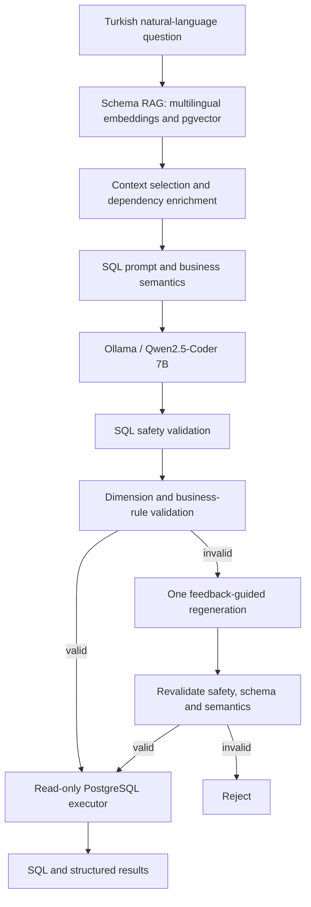

# InsightPilot AI — Implemented Architecture

**Documentation checkpoint:** 12 November 2026. This page describes implemented paths rather than planned features.

## System paths

The diagram is a conceptual overview; consult the implementation for the exact order of individual validators and retry branches.

## Data foundation

- Olist dataset: nine PostgreSQL tables and 1,550,922 source records.
- Six physical foreign keys link orders, customers, order items, payments and reviews.
- `geolocation` is not directly joined through a physical foreign key because ZIP-prefix values are not unique.
- `semantic/business_semantics.yaml` defines application-level business context, separate from physical constraints.

## Dashboard and Text-to-SQL are separate

The Streamlit dashboard uses application-defined KPI queries. The Text-to-SQL backend is exercised through Python services and evaluation scripts; a conversational Streamlit interface is **not** yet claimed. FastAPI, LangGraph orchestration, Docker and CI/CD remain planned in the supplied README.

## Safety and correctness boundaries

SQLGlot-based checks, a restricted read-only database role, read-only transactions and statement timeouts provide defense in depth. Semantic checks target selected known error patterns; they do not prove that arbitrary generated SQL is logically correct. JOIN multiplicity, ambiguous requests and multi-metric questions require further evaluation.

## Further reading

- [Semantic layer](semantic_layer.md)
- [Advanced SQL evaluation](advanced_sql_evaluation.md)
- [Schema RAG validation](schema_rag_validation_results.md)
- [Development log](development_log.md)
